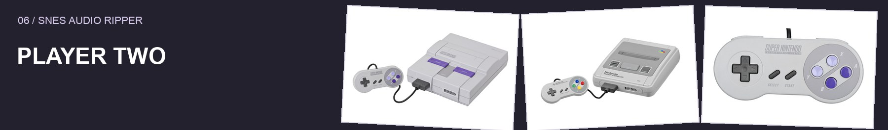
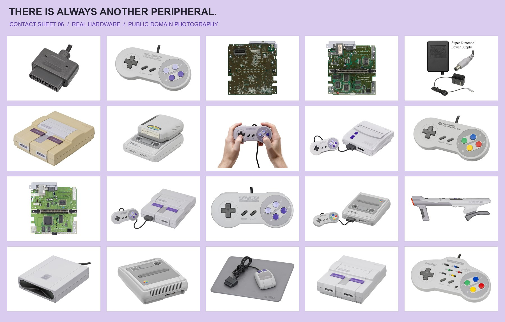
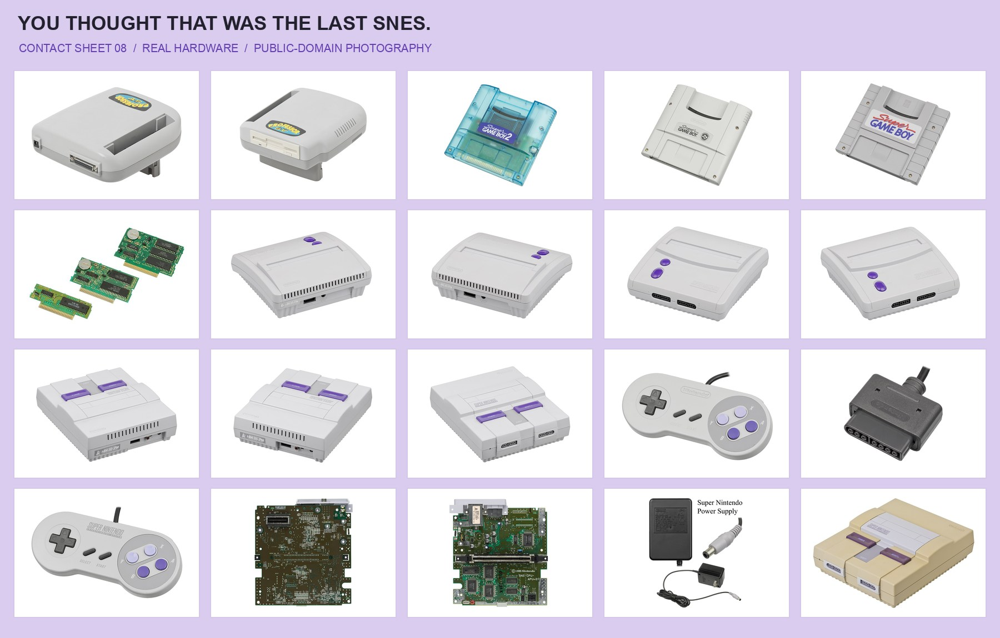

# Credits

## Original Windows release

**Samsqwamch** created **SNES Audio Ripper**, including the original Windows application, retro interface, artwork, and extraction engine.

- Original project: https://github.com/Samsqwamch/SNES_Audio_Ripper
- Original Windows release used by this port: https://github.com/Samsqwamch/SNES_Audio_Ripper/releases/tag/v1.0.0

The original application source and artwork are included with permission from the original author, as confirmed by PunchBro. This macOS project builds on that work. It does not claim authorship of the original app or engine and is not an official upstream release.

## macOS port

**PunchBro** commissioned and publishes this port at https://github.com/punchbrotv/snes-audio-ripper-macos.

**Codex by OpenAI** implemented the macOS adaptation and build tooling, and performed automated and GUI validation under PunchBro's direction.

Codex: https://openai.com/codex/

## Supporting projects

- [Jon Kubis / LogicProFormatWriter](https://github.com/jonkubis/LogicProFormatWriter) — MIT-licensed native Logic project creation.
- Python Software Foundation and PyInstaller contributors — self-contained Logic exporter runtime and packaging.
- Electron — application runtime.
- Snes9x and libretro — native SNES emulator core and frontend API.
- Koffi — native-library bindings.
- spc-converter and its SPC-player contributors — WebAssembly sound-chip rendering.
- @breezystack/lamejs and LAME contributors — MP3 encoding.

See THIRD_PARTY_NOTICES.md for versions, source links, and license information. No endorsement by any credited project or company is implied.

## README photography

The documentation uses manually composed collages of real SNES hardware photos by **Evan-Amos / Vanamo Media**, released into the public domain on Wikimedia Commons. No AI-generated imagery is used. These are independent hardware photographs, not official Nintendo advertisements. See [photo sources and editing notes](docs/assets/SOURCES.md).

