<p align="center">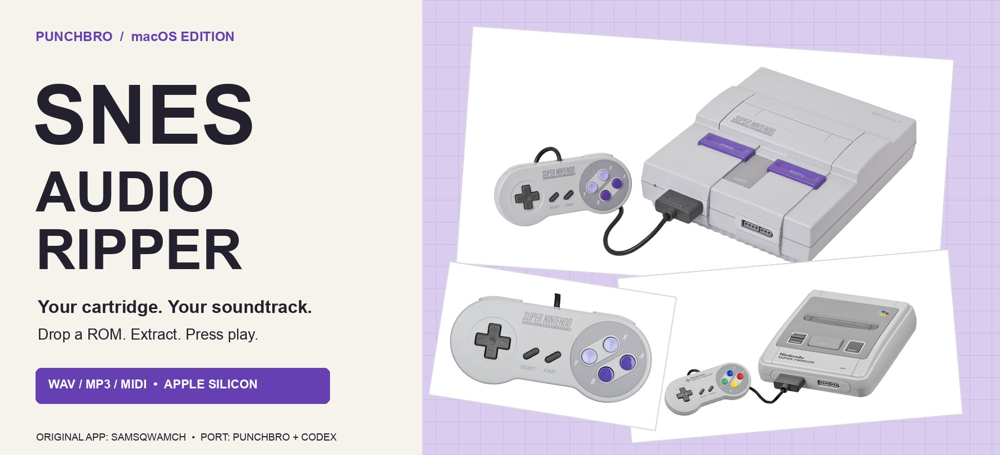</p>

<h1 align="center">SNES Audio Ripper for macOS</h1>
<p align="center"><b>Little gray console. Ridiculously good music. Now on your Mac.</b></p>
<p align="center">
  
  
  
  <a href="https://github.com/punchbrotv/snes-audio-ripper-macos/releases/latest"></a>
</p>
<p align="center">
  <a href="#download">Download</a> · <a href="#use">Use</a> · <a href="#how-it-works">How it works</a> · <a href="#build">Build</a> · <a href="#credits">Credits</a> · <a href="docs/GALLERY.md">Even more SNES</a>
</p>

An unofficial Apple Silicon port of **[Samsqwamch’s SNES Audio Ripper](https://github.com/Samsqwamch/SNES_Audio_Ripper/releases/tag/v1.0.0)**. Drop in a SNES ROM or single-ROM ZIP, export music and sound effects as **WAV, MP3, or MIDI**. Preview WAV/MP3 in the built-in player; open MIDI in your DAW.

**Original Windows app and extraction engine: Samsqwamch. macOS port: [PunchBro](https://github.com/punchbrotv), built with [Codex by OpenAI](https://openai.com/codex/).**

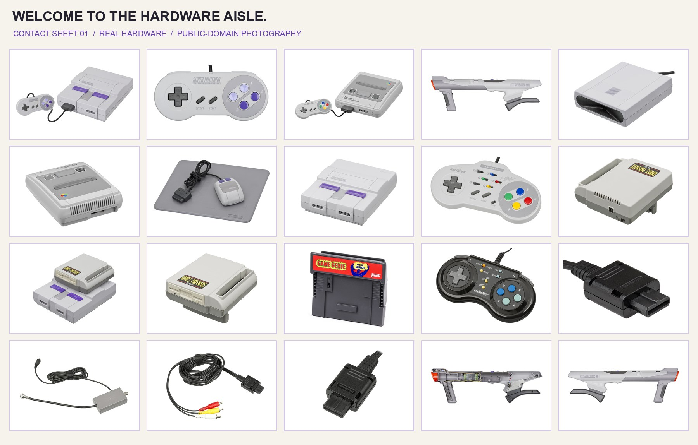

## Download

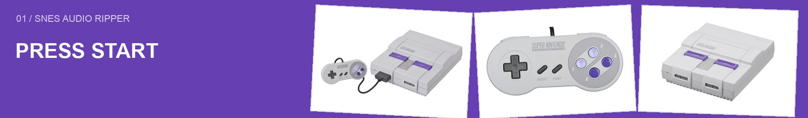

### [⬇ Download the Mac app](https://github.com/punchbrotv/snes-audio-ripper-macos/releases/latest)

Download **SNES-Audio-Ripper-macOS-arm64.zip**, unzip it, and move **SNES Audio Ripper.app** to Applications. Requires **an Apple Silicon Mac running macOS 13 or later**. Intel Macs are not supported by this build.

The download includes the app, emulator, and audio tools. **No Node.js, Windows installer, or source gathering is needed to run it.** Developers can build directly from the application source checked into this repository.

The app is ad-hoc signed, not Apple-notarized. If macOS blocks it, use **System Settings → Privacy & Security → Open Anyway** after trying to open it, if you trust this download. Release assets include a SHA-256 checksum file.

| Small app rituals | What you get |
| :--- | :--- |
| 📦 Drop a ROM or ZIP | `.sfc`, `.smc`, and single-ROM ZIP loading; split files supported |
| 🎵 Extract the sound | WAV or MP3 audio; experimental editable MIDI notes |
| ▶ Press play | Original retro interface with a built-in audio player |
| ⌘ Make yourself at home | Native file dialogs, ⌘O, and an output-folder picker |
| ⏹ Change your mind | Background extraction with cancellation; completed files stay saved |
| 🗂 Run it again | Numbered output folders preserve earlier exports |

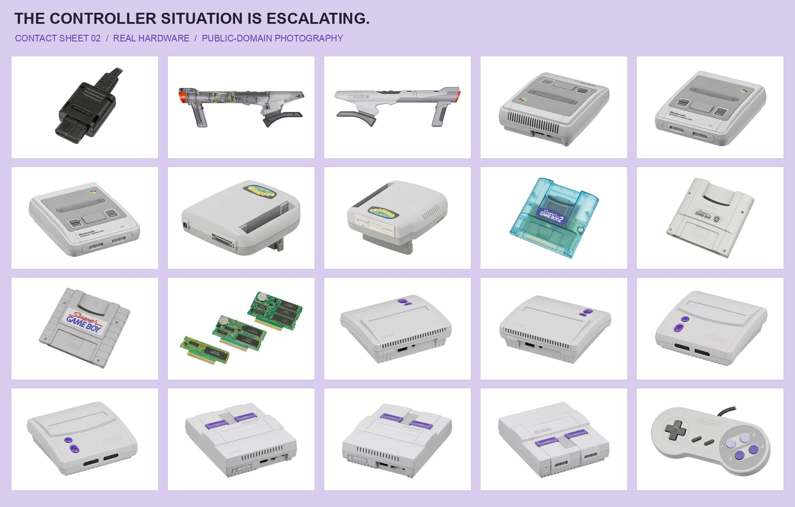

## Use

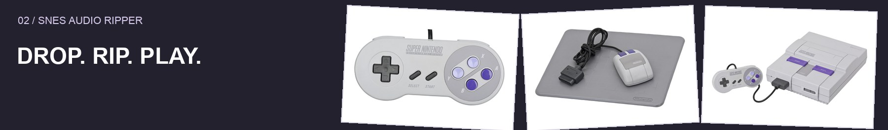

Choose **EXPORT AS → MP3, WAV, or MIDI** before opening a ROM. Your choice is remembered.

| Format | Best for |
| :--- | :--- |
| **MP3** | Compact, ready-to-listen audio |
| **WAV** | Lossless 16-bit PCM audio for editing and sampling |
| **MIDI (experimental)** | Editable notes in eight voice tracks; estimated sample tuning and piano placeholders you can replace in your DAW |

MIDI reconstructs performance data from sound-chip commands. It does not contain the original samples, envelopes, or DSP effects. Unpitched samples use a placeholder note; sounds without recoverable note events are skipped. Click an exported MIDI file to open it in your system’s MIDI app.

1. **Drop** a ROM or ZIP onto the window, or choose **File → Open ROM…** (⌘O). Unzip archives containing multiple ROMs first.
2. **Extract.** The app creates a game-named folder on your Desktop. Change the destination with **File → Choose Output Folder…** for the current session.
3. **Open the results.** Click a WAV/MP3 track to play it, or a MIDI track to open it in your MIDI app. **FOLDER** reveals the files in Finder. The square Stop button stops playback or cancels extraction.

Bring your own ROM. Game ROMs and extracted game audio are not included in the repository or release.

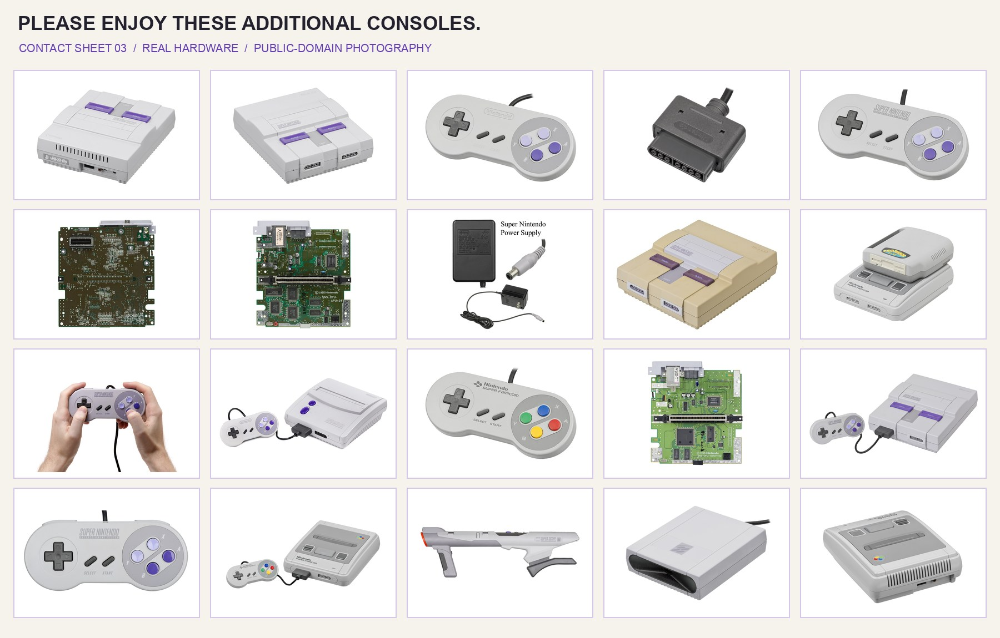

## How it works

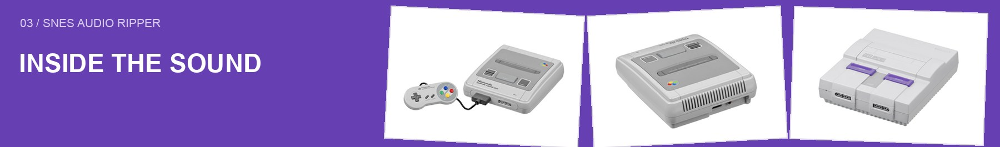

A SNES game usually doesn't store its soundtrack as a folder of ready-made songs. Think of it as a tiny band packed into a cartridge:

- **Instrument samples** are short recordings, such as a drum hit or a bit of a flute tone.
- **Musical instructions** say which notes to play, how long to hold them, and when to loop.
- **A sound program** acts as the conductor, telling the SNES sound hardware how to combine everything.

The ripper finds those ingredients and runs the sound program on **emulated sound hardware**: software that reproduces the behavior of the console's audio chips. It calculates the resulting sound wave, tidies up the ending, and writes WAV audio or compresses it into MP3. For MIDI, it follows the sound program’s note and pitch commands instead of storing the waveform.

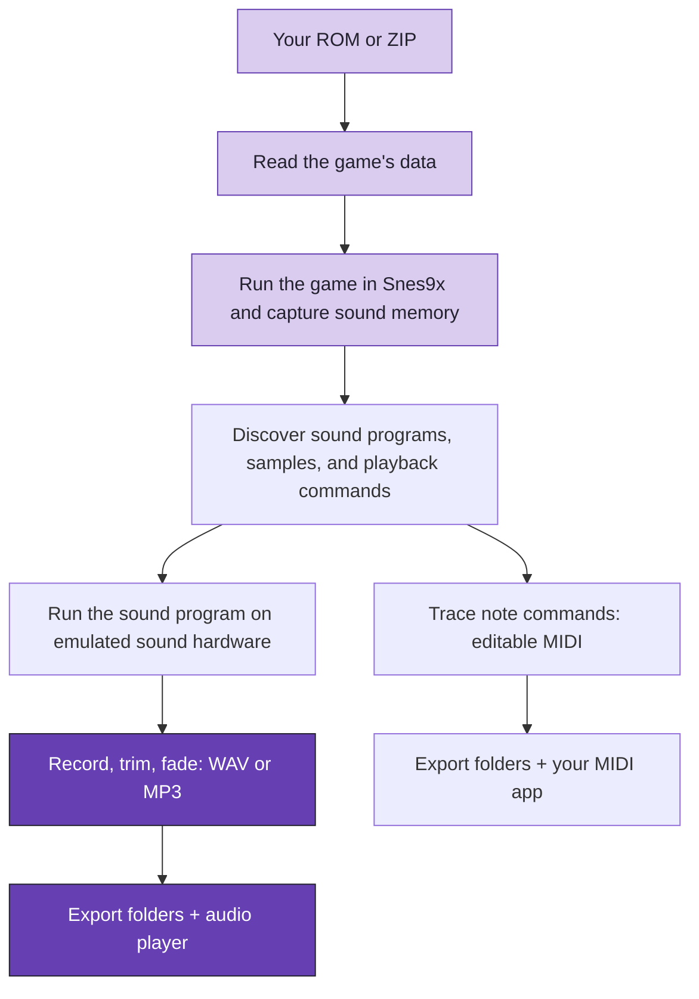

**Finding the band.** A headless emulator runs the game with simulated button presses, captures sound memory, and searches for commands that produce distinct audio. The extraction engine works from the data and sound program inside the ROM you supply.

**From memory to music.** The SPC sound renderer turns the game's sound program and samples into raw audio (PCM). The app saves those samples in WAV files or compresses them into MP3. MIDI instead records note events traced from the sound program. Extraction runs in a background worker so the window can stay responsive.

**Sometimes the map is missing.** Different games use different sound programs. If discovery finds no usable recordings, WAV and MP3 exports can fall back to scanning for raw compressed instrument samples (BRR). These are individual sounds; that fallback does not guarantee complete songs or their original in-game pitch. MIDI needs recoverable note events and cannot use this raw-sample fallback.

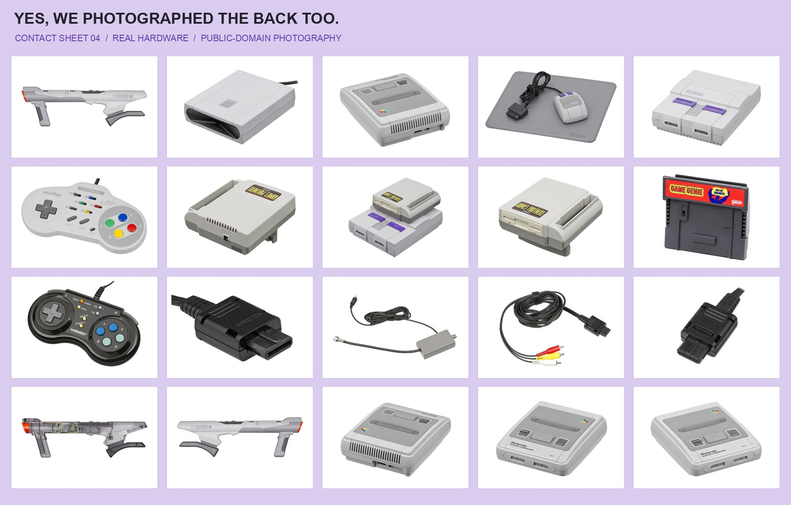

Want the code tour? Start with [the application guide](app/README.md).

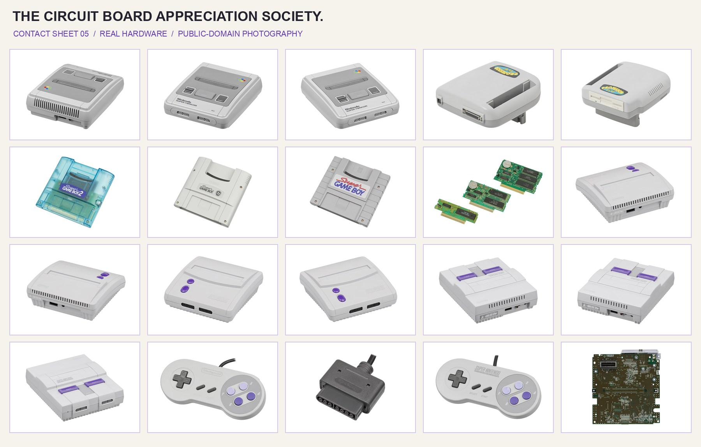

## Build

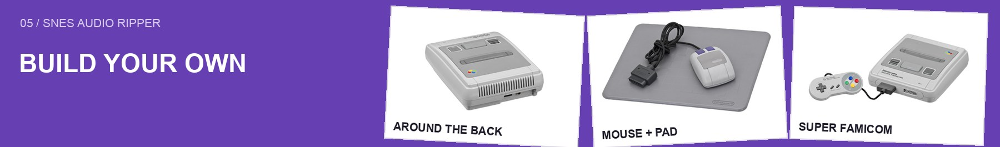

Requires **macOS 13+, Apple Silicon, Node.js 22.12+, and Xcode Command Line Tools**. Install the latter with `xcode-select --install` if needed.

```sh
git clone https://github.com/punchbrotv/snes-audio-ripper-macos.git
cd snes-audio-ripper-macos
npm ci
npm run setup
npm test
npm run build
open 'dist/SNES Audio Ripper.app'
```

**The application source lives in `app/`.** Setup installs pinned dependencies and compiles a pinned Snes9x core. It does not download or unpack the Windows release. Network access is needed for dependency setup; the finished app includes its runtime and extraction dependencies. Optional cover-art lookup uses the network when available.

<details>
<summary><b>Command line and repository map</b></summary>

```sh
npm run rip -- '/path/to/game.zip' '/path/to/output' wav
# Last argument: mp3 (default), wav, or midi
```

| Location | What's inside |
| :--- | :--- |
| [`app/`](app/README.md) | Full application source, macOS integration, audio engine |
| [`scripts/`](scripts/README.md) | Dependency setup, native-core build, packaging, validation |
| [`tests/`](tests/README.md) | Synthetic regression tests; no ROM fixtures |
| [`docs/`](docs/README.md) | Documentation, public-domain photo gallery, release notes |
| `build/`, `dist/`, `output/` | Local generated files, excluded from Git |

The original source and artwork are included with permission from the original author, as confirmed by PunchBro. Original port contributions have a scoped [MIT license](LICENSE); upstream components retain their own terms. See [third-party notices](THIRD_PARTY_NOTICES.md).

</details>

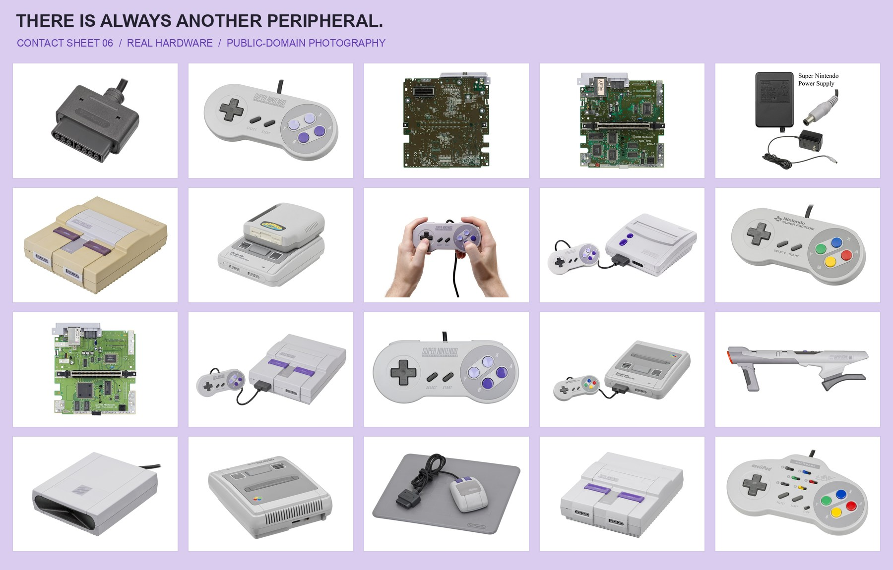

## Credits

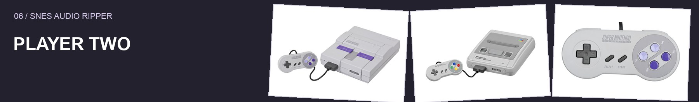

| Player | Contribution |
| :--- | :--- |
| **[Samsqwamch](https://github.com/Samsqwamch/SNES_Audio_Ripper/releases/tag/v1.0.0)** | Original Windows app, extraction engine, retro interface, and app artwork |
| **[PunchBro](https://github.com/punchbrotv)** | Commissioned and publishes this macOS port |
| **[Codex by OpenAI](https://openai.com/codex/)** | macOS adaptation, build tooling and validation under PunchBro's direction |
| **[Evan-Amos / Vanamo Media](https://commons.wikimedia.org/wiki/User:Evan-Amos)** | Every real hardware photograph decorating these docs; public domain |
| **The supporting projects** | Electron, Snes9x/libretro, Koffi, spc-converter, lamejs/LAME |

[Full credits](CREDITS.md) · [Component notices](THIRD_PARTY_NOTICES.md) · [Every photo's source and editing notes](docs/assets/SOURCES.md)

This is an independent port, not an official release or endorsement by Nintendo, Samsqwamch, or OpenAI. The hardware photos are independent public-domain photography, not official Nintendo advertisements. **No AI-generated imagery is used.**

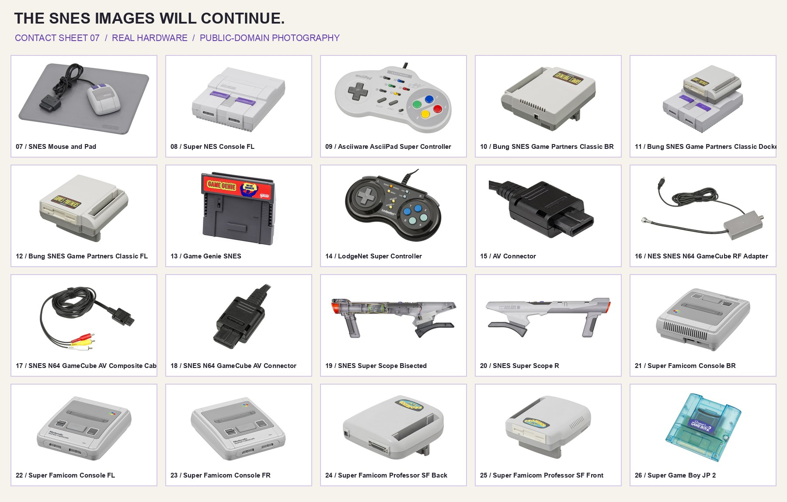

## Yes, more SNES

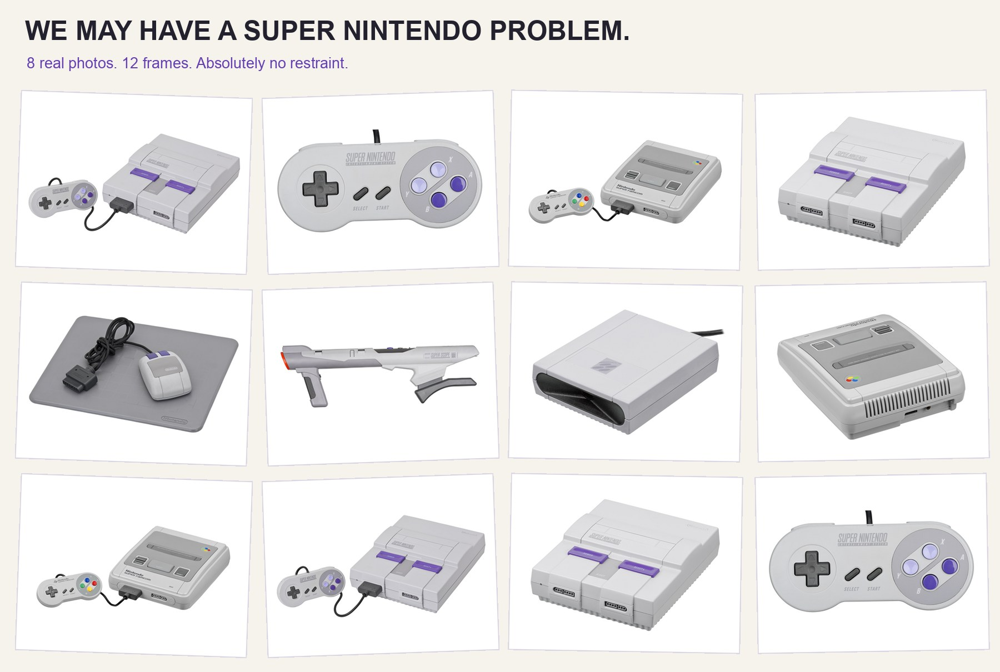

You reached the end of an audio tool's README and somehow toured a hardware museum. **[There is still more SNES in the gallery.](docs/GALLERY.md)**

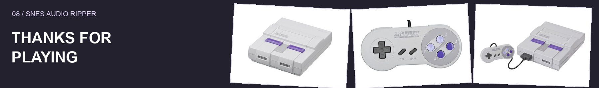

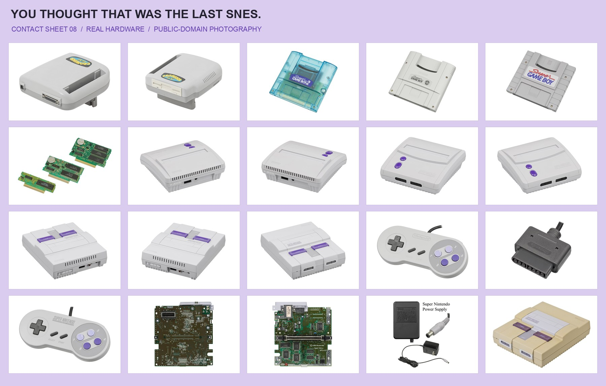
