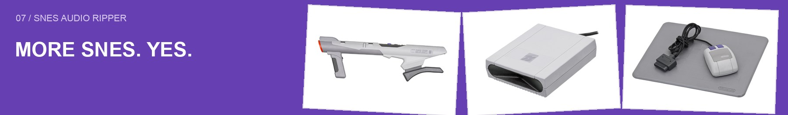
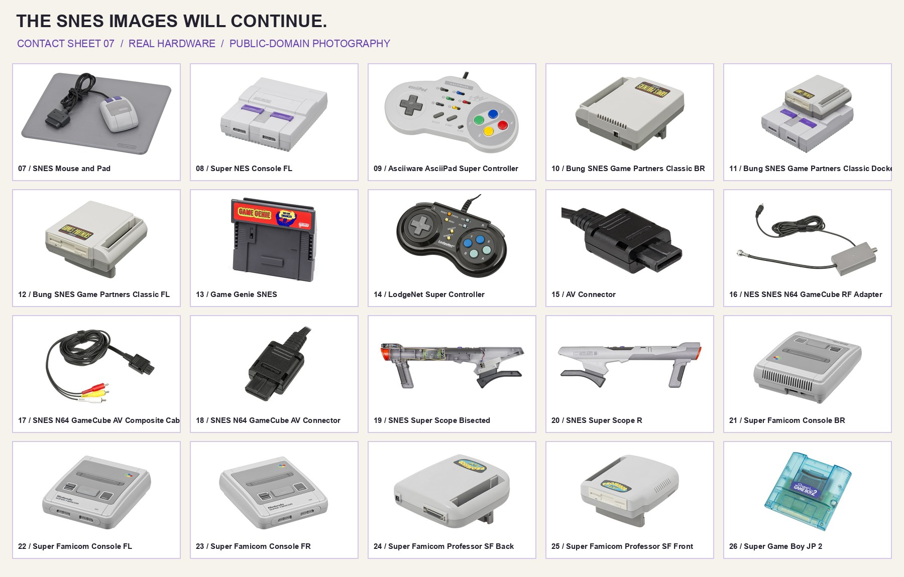
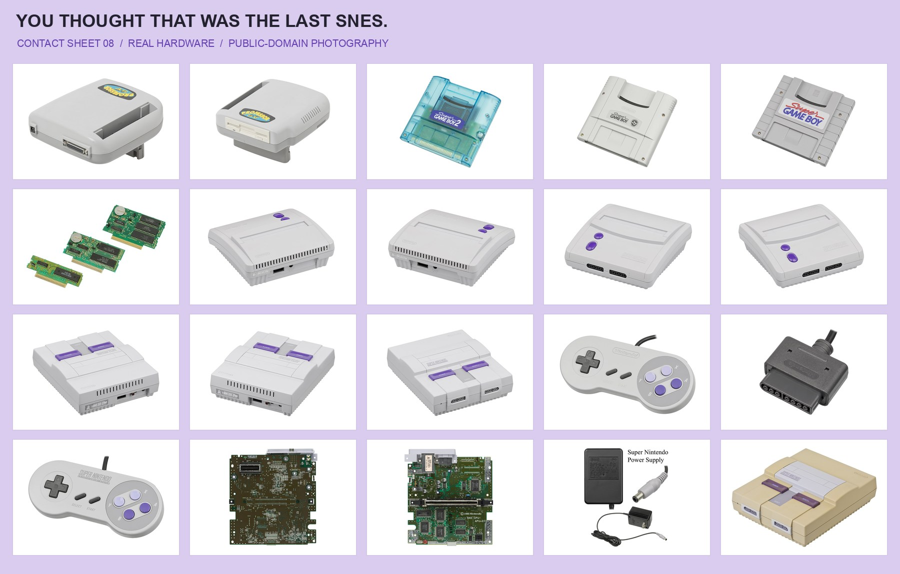

# Component provenance and licensing

## Original application

[SNES Audio Ripper v1.0.0 by Samsqwamch](https://github.com/Samsqwamch/SNES_Audio_Ripper/releases/tag/v1.0.0) is the basis of this unofficial port. The original application source and artwork are included with permission from the original author, as confirmed by PunchBro. The code was recovered from the official v1.0.0 release and adapted for macOS; attribution is retained in CREDITS.md. The scoped MIT license covers the original port contributions and does not relicense the upstream application, artwork, or dependencies.

Original installer SHA-256: `3304e159490baaacfb77408d20c555d6fc938a895aee811b38af604215283820`.

## Runtime and audio dependencies

- [Electron](https://github.com/electron/electron) 45.3.1 — MIT; Electron and Chromium notices are copied into the built app's Resources.
- [Koffi](https://github.com/Koromix/koffi) 2.16.3 — MIT; package license retained locally.
- [@breezystack/lamejs](https://www.npmjs.com/package/@breezystack/lamejs) 1.2.7 — LGPL-3.0; package license retained locally.
- [spc-converter](https://github.com/kethinov/spc-converter) 1.0.0 — LGPL-2.1-only; package license retained locally. Its WebAssembly SPC player credits the upstream SPC-player project in its source.
- [Snes9x/libretro](https://github.com/libretro/snes9x) — native core compiled from commit `fae2fea08f74180759ef540ee94259213f503480` (Snes9x 1.63). Source archive SHA-256: `0d4b0c4181d66668ec0040eb17f90a559f7b7fa6cbd9198593c3bdbe79acd029`. The upstream Snes9x license, including its restrictions, is copied to the generated `app/licenses/Snes9x.txt`. It is not covered by this project's MIT license.

The initial local test used a libretro nightly core reporting the same source revision. Public setup compiles the pinned source instead of depending on a mutable nightly binary URL.

ROMs and extracted game audio are excluded from this repository.

## Logic project export

- [LogicProFormatWriter](https://github.com/jonkubis/LogicProFormatWriter) by Jon Kubis — MIT, pinned commit `9935ca88a3fad4c4232eb9dd755149e9cc9b9b65`. The structural writer and minimal seed data are vendored in `vendor/logicx/`; its license is included in the app.
- Python 3.12.16 — Python Software Foundation license, included in `app/licenses/Python.txt`. The helper contains its own interpreter from [Astral’s python-build-standalone release 20261110](https://github.com/astral-sh/python-build-standalone/releases/tag/20261110); users do not install Python. The archive and SHA-256 are pinned in `scripts/build-logic.cjs`. Its third-party dependency notices are included in `app/licenses/python-runtime/`.
- PyInstaller 6.16.0 — GPL with the bootloader exception permitting distribution of the bundled application under its own license. License and exception included in `app/licenses/PyInstaller.txt`. Build dependencies are pinned in `scripts/logic-build-requirements.txt`.
- The empty Sampler state in `app/logic-data/` was authored for this project in Logic. It contains no game audio or Apple instrument samples.
- EXS field references: [ConvertWithMoss format research](https://github.com/git-moss/ConvertWithMoss/tree/master/src/main/java/de/mossgrabers/convertwithmoss/format/exs). The project’s EXS serializer is independently implemented; no ConvertWithMoss code is bundled.

## README artwork

The collage uses public-domain photographs by Evan-Amos / Vanamo Media. Exact source pages, file hashes, and editing notes are recorded in [docs/assets/SOURCES.md](docs/assets/SOURCES.md). Nintendo names and marks identify the photographed hardware; this project is independent of Nintendo.

