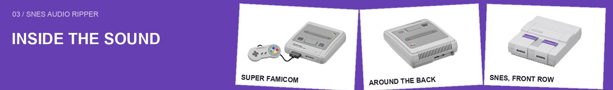
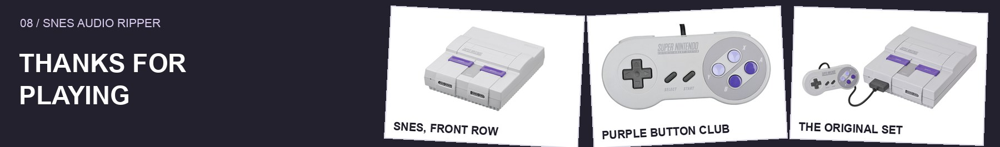
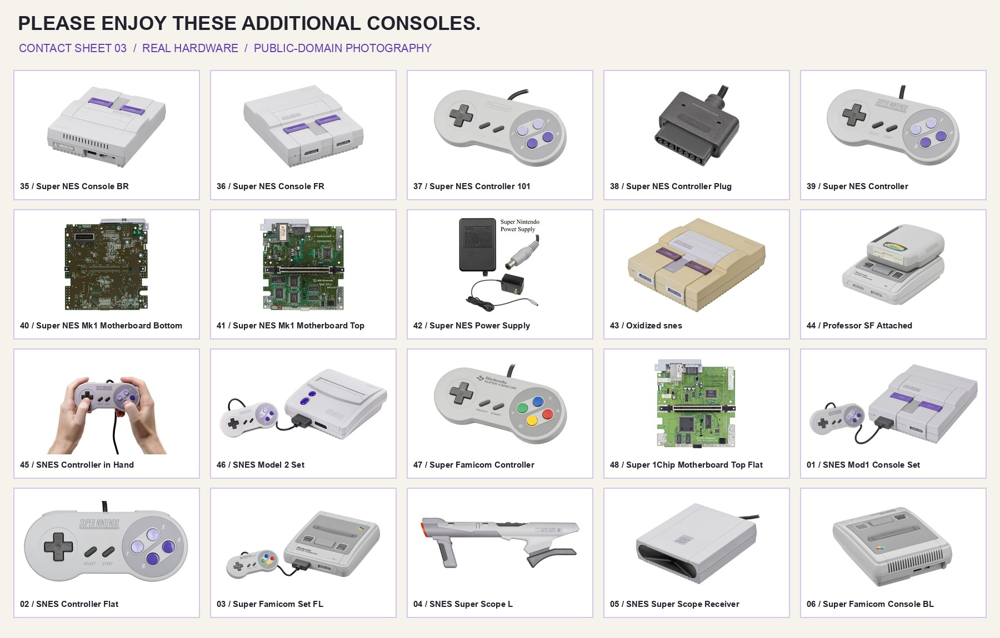
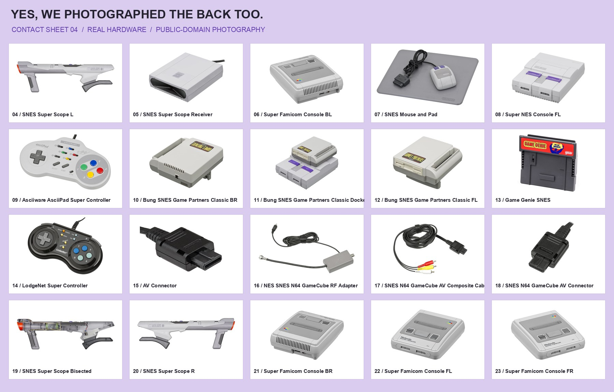

# Application source

The full application source is checked in here. [Build instructions](../README.md#build) live in the main README. Samsqwamch created the original Windows app and engine; PunchBro publishes this port, developed with Codex by OpenAI. See [credits](../CREDITS.md).

| File | Job |
| :--- | :--- |
| `main.js`, `preload.js`, `index.html` | Electron window, macOS menus, file selection, and music player |
| `input.js`, `parts.js` | Read ROMs, single-ROM ZIPs, and split files |
| `rip-worker.js`, `rip.js` | Background extraction, progress, cancellation, output folders |
| `record.js`, `songs.js`, `driver.js` | Emulate the game, capture sound memory, discover playback commands |
| `spc.js`, `spc700.js`, `render.js` | Sound-state handling, sound-CPU logic, and audio rendering |
| `mp3.js`, `wav.js` | Audio encoding and file output |
| `brr.js` | Raw instrument-sample fallback |
| `art.js`, `cover.js` | Optional cover-art lookup and processing |

`node_modules/` and `cores/` are installed by setup and ignored by Git. Game data and extracted audio are never source dependencies.

Hardware photography: Evan-Amos, public domain. [Sources](../docs/assets/SOURCES.md).

