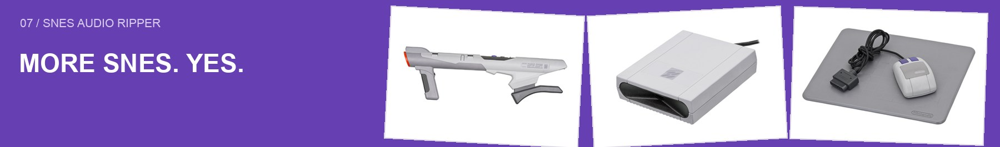
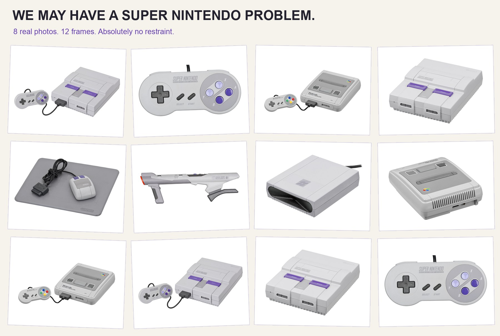
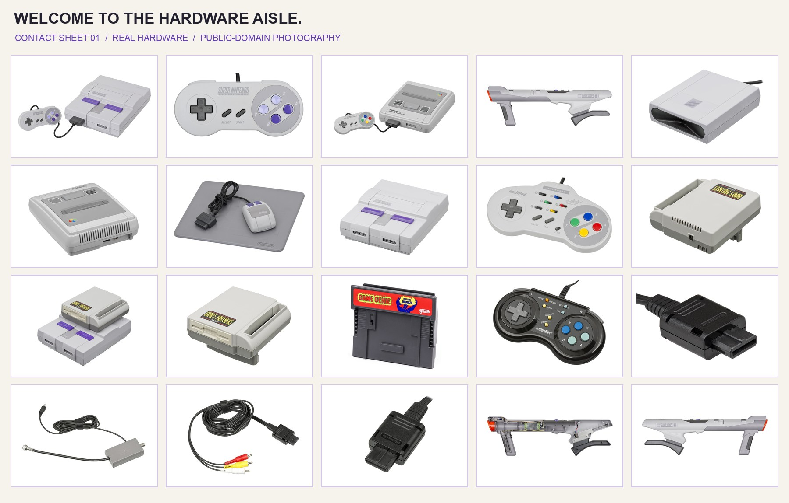
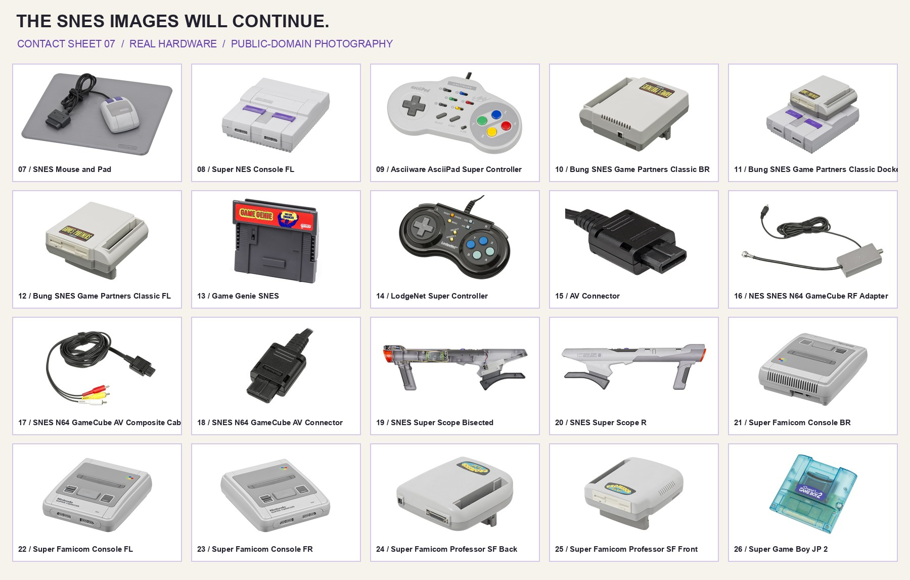

# Documentation, with excessive Super Nintendo

- [Start here: download and use](../README.md)
- [How the sound becomes an export](../README.md#how-it-works)
- [The hardware gallery](GALLERY.md)
- [Every photograph's source](assets/SOURCES.md)
- [Application code tour](../app/README.md)
- [Build workshop](../scripts/README.md)
- [Credits](../CREDITS.md)

Photography by Evan-Amos / Vanamo Media, public domain. No AI-generated imagery.

