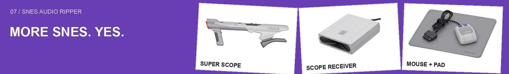

# Public-domain photo sources

All hardware photographs used in these documentation collages are by **Evan-Amos / Vanamo Media**, released into the public domain on their Wikimedia Commons file pages (PD-self). These are independent photographs, not Nintendo promotional advertisements. No AI-generated imagery is used.

## Editing

The collages use conventional Pillow compositing: resizing, whole-photo placement, rotation, borders, backgrounds, and typography. Photographs retain their original hardware appearance. The eight initial JPEG source files are preserved; the expanded archive stores smaller, recompressed full-frame copies for faster repository browsing. No new hardware or scenery was synthesized. Nintendo names and marks identify photographed objects.

Run `python3 scripts/make-readme-art.py` from the repository root with Pillow installed to rebuild the collages. The compositor uses macOS Arial fonts without distributing font files.

## Source register

The machine-readable [catalog](source/catalog.json) records original URLs and SHA-256 hashes. For optimized archive copies, the downloaded original or Commons preview hash and the local edited-file hash are included. Checked on 2026-11-12.

| Photo | Original source and public-domain declaration | Local copy |
| :--- | :--- | :--- |
| 01 | [SNES-Mod1-Console-Set.jpg](https://commons.wikimedia.org/wiki/File:SNES-Mod1-Console-Set.jpg) · PD-self | [JPEG](source/snes-console.jpg) |
| 02 | [SNES-Controller-Flat.jpg](https://commons.wikimedia.org/wiki/File:SNES-Controller-Flat.jpg) · PD-self | [JPEG](source/snes-controller.jpg) |
| 03 | [Nintendo-Super-Famicom-Set-FL.jpg](https://commons.wikimedia.org/wiki/File:Nintendo-Super-Famicom-Set-FL.jpg) · PD-self | [JPEG](source/sfc.jpg) |
| 04 | [Nintendo-SNES-Super-Scope-L.jpg](https://commons.wikimedia.org/wiki/File:Nintendo-SNES-Super-Scope-L.jpg) · PD-self | [JPEG](source/scope.jpg) |
| 05 | [Nintendo-SNES-Super-Scope-Receiver.jpg](https://commons.wikimedia.org/wiki/File:Nintendo-SNES-Super-Scope-Receiver.jpg) · PD-self | [JPEG](source/receiver.jpg) |
| 06 | [Nintendo-Super-Famicom-Console-BL.jpg](https://commons.wikimedia.org/wiki/File:Nintendo-Super-Famicom-Console-BL.jpg) · PD-self | [JPEG](source/sfc-back.jpg) |
| 07 | [SNES-Mouse-and-Pad.jpg](https://commons.wikimedia.org/wiki/File:SNES-Mouse-and-Pad.jpg) · PD-self | [JPEG](source/mouse.jpg) |
| 08 | [Nintendo-Super-NES-Console-FL.jpg](https://commons.wikimedia.org/wiki/File:Nintendo-Super-NES-Console-FL.jpg) · PD-self | [JPEG](source/snes-front.jpg) |
| 09 | [Asciiware-AsciiPad-Super-Nintendo-Controller.jpg](https://commons.wikimedia.org/wiki/File:Asciiware-AsciiPad-Super-Nintendo-Controller.jpg) · PD-self | [JPEG](archive/archive-009.jpg) |
| 10 | [Bung-SNES-Game-Partners-Classic-BR.jpg](https://commons.wikimedia.org/wiki/File:Bung-SNES-Game-Partners-Classic-BR.jpg) · PD-self | [JPEG](archive/archive-010.jpg) |
| 11 | [Bung-SNES-Game-Partners-Classic-Docked.jpg](https://commons.wikimedia.org/wiki/File:Bung-SNES-Game-Partners-Classic-Docked.jpg) · PD-self | [JPEG](archive/archive-011.jpg) |
| 12 | [Bung-SNES-Game-Partners-Classic-FL.jpg](https://commons.wikimedia.org/wiki/File:Bung-SNES-Game-Partners-Classic-FL.jpg) · PD-self | [JPEG](archive/archive-012.jpg) |
| 13 | [Game-Genie-SNES.jpg](https://commons.wikimedia.org/wiki/File:Game-Genie-SNES.jpg) · PD-self | [JPEG](archive/archive-013.jpg) |
| 14 | [LodgeNet-Super-Nintendo-Controller.jpg](https://commons.wikimedia.org/wiki/File:LodgeNet-Super-Nintendo-Controller.jpg) · PD-self | [JPEG](archive/archive-014.jpg) |
| 15 | [Nintendo-AV-Connector.jpg](https://commons.wikimedia.org/wiki/File:Nintendo-AV-Connector.jpg) · PD-self | [JPEG](archive/archive-015.jpg) |
| 16 | [Nintendo-NES-SNES-N64-GameCube-RF-Adapter.jpg](https://commons.wikimedia.org/wiki/File:Nintendo-NES-SNES-N64-GameCube-RF-Adapter.jpg) · PD-self | [JPEG](archive/archive-016.jpg) |
| 17 | [Nintendo-SNES-N64-GameCube-AV-Composite-Cable.jpg](https://commons.wikimedia.org/wiki/File:Nintendo-SNES-N64-GameCube-AV-Composite-Cable.jpg) · PD-self | [JPEG](archive/archive-017.jpg) |
| 18 | [Nintendo-SNES-N64-GameCube-AV-Connector.jpg](https://commons.wikimedia.org/wiki/File:Nintendo-SNES-N64-GameCube-AV-Connector.jpg) · PD-self | [JPEG](archive/archive-018.jpg) |
| 19 | [Nintendo-SNES-Super-Scope-Bisected.jpg](https://commons.wikimedia.org/wiki/File:Nintendo-SNES-Super-Scope-Bisected.jpg) · PD-self | [JPEG](archive/archive-019.jpg) |
| 20 | [Nintendo-SNES-Super-Scope-R.jpg](https://commons.wikimedia.org/wiki/File:Nintendo-SNES-Super-Scope-R.jpg) · PD-self | [JPEG](archive/archive-020.jpg) |
| 21 | [Nintendo-Super-Famicom-Console-BR.jpg](https://commons.wikimedia.org/wiki/File:Nintendo-Super-Famicom-Console-BR.jpg) · PD-self | [JPEG](archive/archive-021.jpg) |
| 22 | [Nintendo-Super-Famicom-Console-FL.jpg](https://commons.wikimedia.org/wiki/File:Nintendo-Super-Famicom-Console-FL.jpg) · PD-self | [JPEG](archive/archive-022.jpg) |
| 23 | [Nintendo-Super-Famicom-Console-FR.jpg](https://commons.wikimedia.org/wiki/File:Nintendo-Super-Famicom-Console-FR.jpg) · PD-self | [JPEG](archive/archive-023.jpg) |
| 24 | [Nintendo-Super-Famicom-Professor-SF-Back.jpg](https://commons.wikimedia.org/wiki/File:Nintendo-Super-Famicom-Professor-SF-Back.jpg) · PD-self | [JPEG](archive/archive-024.jpg) |
| 25 | [Nintendo-Super-Famicom-Professor-SF-Front.jpg](https://commons.wikimedia.org/wiki/File:Nintendo-Super-Famicom-Professor-SF-Front.jpg) · PD-self | [JPEG](archive/archive-025.jpg) |
| 26 | [Nintendo-Super-Game-Boy-JP-2.jpg](https://commons.wikimedia.org/wiki/File:Nintendo-Super-Game-Boy-JP-2.jpg) · PD-self | [JPEG](archive/archive-026.jpg) |
| 27 | [Nintendo-Super-Game-Boy-JP.jpg](https://commons.wikimedia.org/wiki/File:Nintendo-Super-Game-Boy-JP.jpg) · PD-self | [JPEG](archive/archive-027.jpg) |
| 28 | [Nintendo-Super-Game-Boy.jpg](https://commons.wikimedia.org/wiki/File:Nintendo-Super-Game-Boy.jpg) · PD-self | [JPEG](archive/archive-028.jpg) |
| 29 | [Nintendo-Super-NES-Cartridge-Boards.jpg](https://commons.wikimedia.org/wiki/File:Nintendo-Super-NES-Cartridge-Boards.jpg) · PD-self | [JPEG](archive/archive-029.jpg) |
| 30 | [Nintendo-Super-NES-Console-101-BL.jpg](https://commons.wikimedia.org/wiki/File:Nintendo-Super-NES-Console-101-BL.jpg) · PD-self | [JPEG](archive/archive-030.jpg) |
| 31 | [Nintendo-Super-NES-Console-101-BR.jpg](https://commons.wikimedia.org/wiki/File:Nintendo-Super-NES-Console-101-BR.jpg) · PD-self | [JPEG](archive/archive-031.jpg) |
| 32 | [Nintendo-Super-NES-Console-101-FL.jpg](https://commons.wikimedia.org/wiki/File:Nintendo-Super-NES-Console-101-FL.jpg) · PD-self | [JPEG](archive/archive-032.jpg) |
| 33 | [Nintendo-Super-NES-Console-101-FR.jpg](https://commons.wikimedia.org/wiki/File:Nintendo-Super-NES-Console-101-FR.jpg) · PD-self | [JPEG](archive/archive-033.jpg) |
| 34 | [Nintendo-Super-NES-Console-BL.jpg](https://commons.wikimedia.org/wiki/File:Nintendo-Super-NES-Console-BL.jpg) · PD-self | [JPEG](archive/archive-034.jpg) |
| 35 | [Nintendo-Super-NES-Console-BR.jpg](https://commons.wikimedia.org/wiki/File:Nintendo-Super-NES-Console-BR.jpg) · PD-self | [JPEG](archive/archive-035.jpg) |
| 36 | [Nintendo-Super-NES-Console-FR.jpg](https://commons.wikimedia.org/wiki/File:Nintendo-Super-NES-Console-FR.jpg) · PD-self | [JPEG](archive/archive-036.jpg) |
| 37 | [Nintendo-Super-NES-Controller-101.jpg](https://commons.wikimedia.org/wiki/File:Nintendo-Super-NES-Controller-101.jpg) · PD-self | [JPEG](archive/archive-037.jpg) |
| 38 | [Nintendo-Super-NES-Controller-Plug.jpg](https://commons.wikimedia.org/wiki/File:Nintendo-Super-NES-Controller-Plug.jpg) · PD-self | [JPEG](archive/archive-038.jpg) |
| 39 | [Nintendo-Super-NES-Controller.jpg](https://commons.wikimedia.org/wiki/File:Nintendo-Super-NES-Controller.jpg) · PD-self | [JPEG](archive/archive-039.jpg) |
| 40 | [Nintendo-Super-NES-Mk1-Motherboard-Bottom.jpg](https://commons.wikimedia.org/wiki/File:Nintendo-Super-NES-Mk1-Motherboard-Bottom.jpg) · PD-self | [JPEG](archive/archive-040.jpg) |
| 41 | [Nintendo-Super-NES-Mk1-Motherboard-Top.jpg](https://commons.wikimedia.org/wiki/File:Nintendo-Super-NES-Mk1-Motherboard-Top.jpg) · PD-self | [JPEG](archive/archive-041.jpg) |
| 42 | [Nintendo-Super-NES-Power-Supply.jpg](https://commons.wikimedia.org/wiki/File:Nintendo-Super-NES-Power-Supply.jpg) · PD-self | [JPEG](archive/archive-042.jpg) |
| 43 | [Oxidized-snes.jpg](https://commons.wikimedia.org/wiki/File:Oxidized-snes.jpg) · PD-self | [JPEG](archive/archive-043.jpg) |
| 44 | [Professor-SF-Attached.jpg](https://commons.wikimedia.org/wiki/File:Professor-SF-Attached.jpg) · PD-self | [JPEG](archive/archive-044.jpg) |
| 45 | [SNES-Controller-in-Hand.jpg](https://commons.wikimedia.org/wiki/File:SNES-Controller-in-Hand.jpg) · PD-self | [JPEG](archive/archive-045.jpg) |
| 46 | [SNES-Model-2-Set.jpg](https://commons.wikimedia.org/wiki/File:SNES-Model-2-Set.jpg) · PD-self | [JPEG](archive/archive-046.jpg) |
| 47 | [Super-Famicom-Controller.jpg](https://commons.wikimedia.org/wiki/File:Super-Famicom-Controller.jpg) · PD-self | [JPEG](archive/archive-047.jpg) |
| 48 | [Super-Nintendo-1Chip-Motherboard-Top-Flat.jpg](https://commons.wikimedia.org/wiki/File:Super-Nintendo-1Chip-Motherboard-Top-Flat.jpg) · PD-self | [JPEG](archive/archive-048.jpg) |
