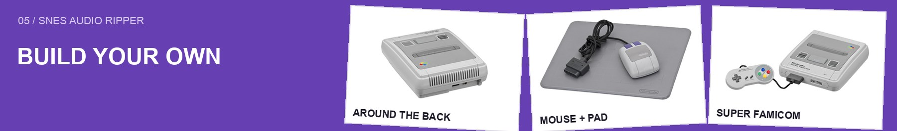
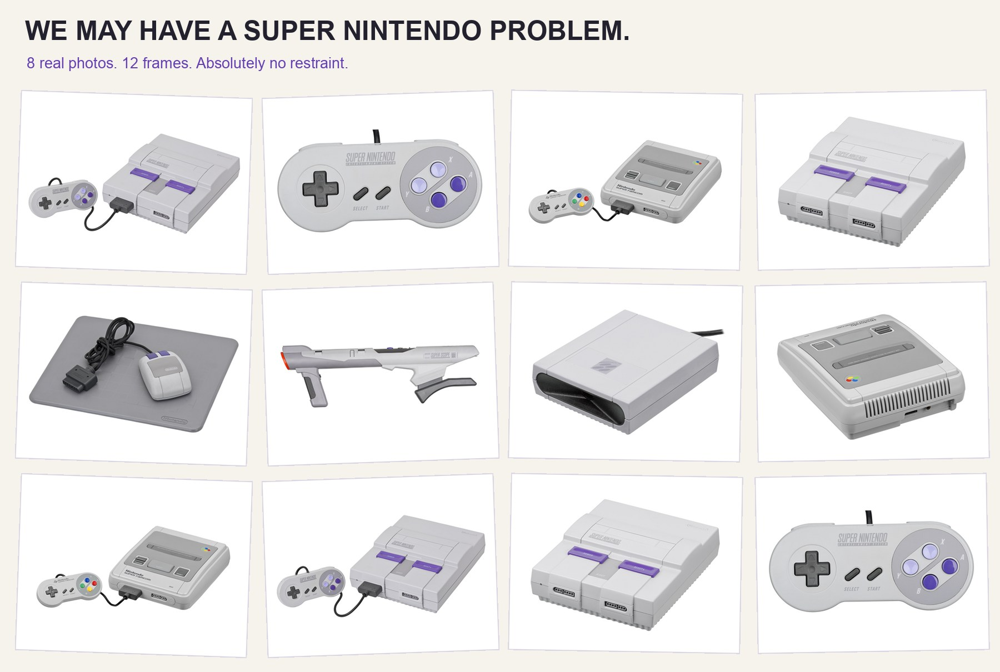
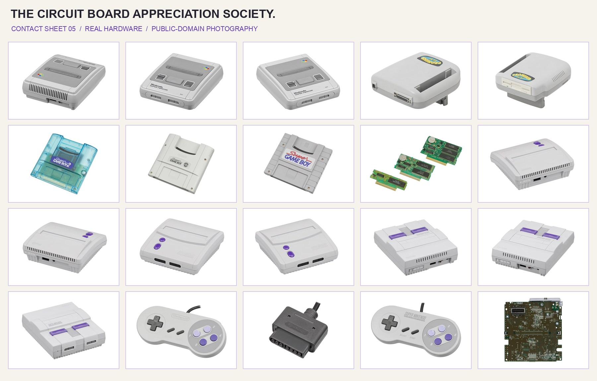
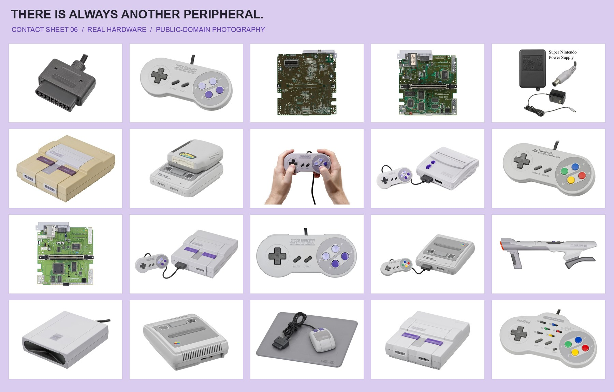

# Workshop

Run these from the repository root. [Complete build instructions](../README.md#build).

| Script | Purpose |
| :--- | :--- |
| `setup.cjs` | Install runtime dependencies, compile the core, and bundle the Logic writer |
| `build-core.cjs` | Download a checksum-verified Snes9x source archive and compile it for arm64 |
| `build-logic.cjs`, `logic-writer.py` | Freeze a self-contained native Logic project writer |
| `build-macos.cjs` | Assemble the self-contained app and verify its ad-hoc signature |
| `rip.cjs` | Command-line extraction using the same engine as the GUI |
| `test-packaged.cjs` | Exercise native bindings and extraction inside the packaged Electron runtime |
| `verify-output.cjs` | Decode exported WAV/MP3 files with FFmpeg and check audio |
| `make-readme-art.py` | Manually compose public-domain photos with Pillow; no image-generation model |

The photo compositor is optional documentation tooling. Pillow is not required to build or run the app.

Hardware photography: Evan-Amos, public domain. [Sources](../docs/assets/SOURCES.md).

