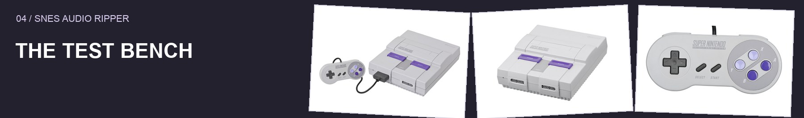
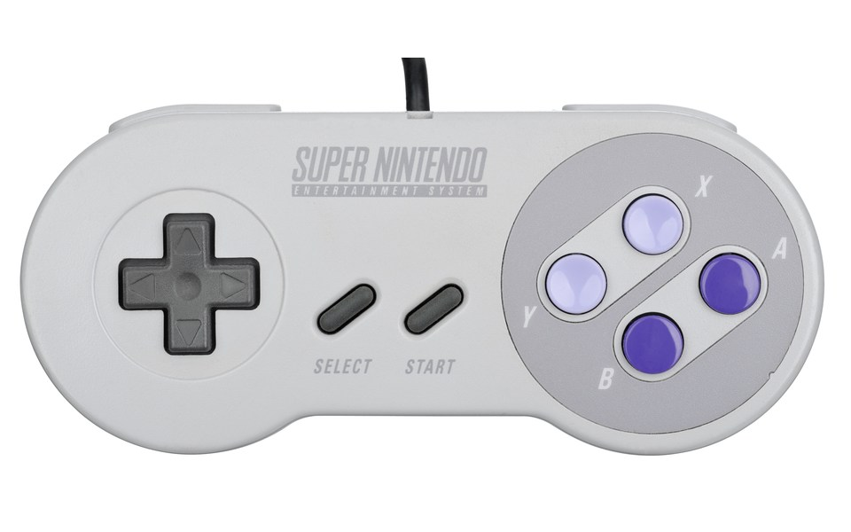
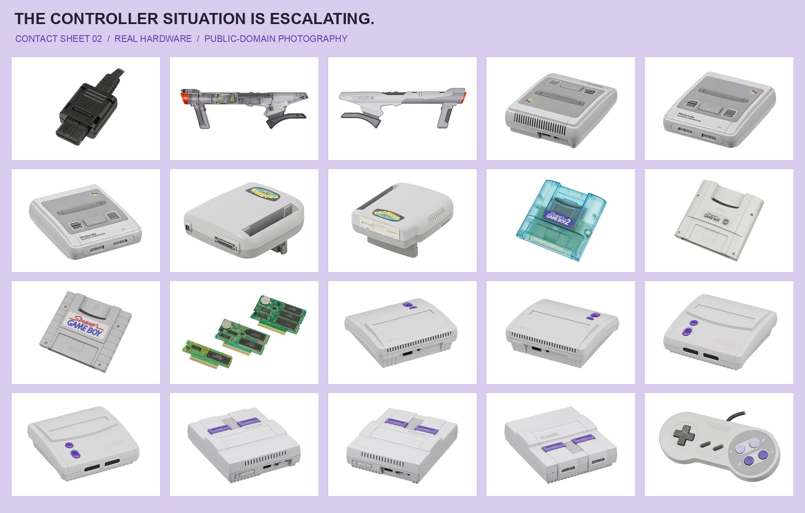
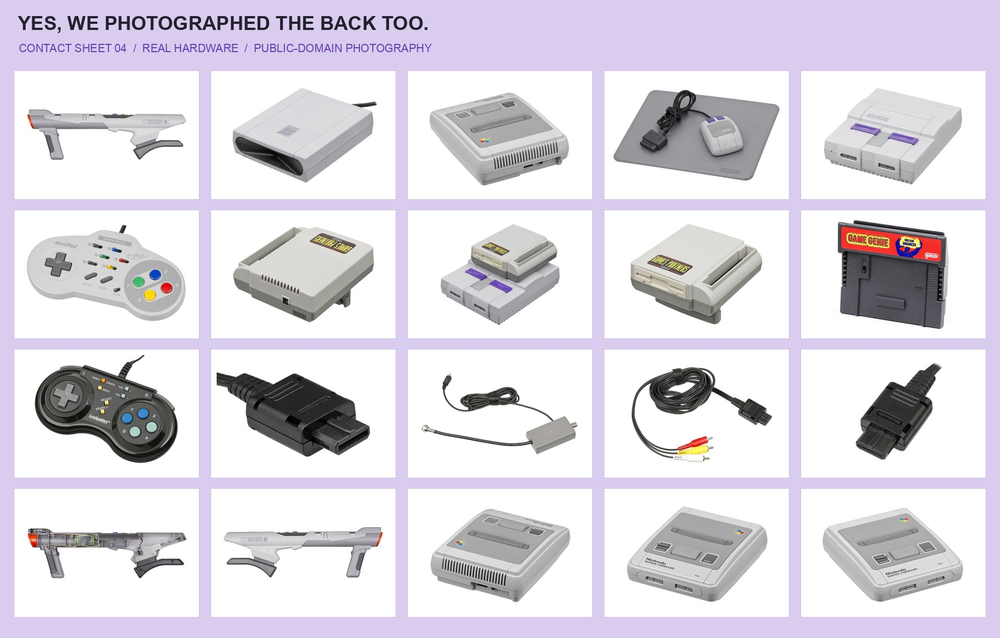

# Developer checks

Run `npm test` after setup. Synthetic fixtures exercise raw and ZIP input, Unicode filenames, ambiguous archives, split-ROM ordering, explicit SPC command ports, and Stop/cancel dispatch. Export checks cover exact WAV samples, MIDI structure and note timing, voice separation, pitch bends, sample tuning, and DSP key-on/key-off tracing. Discovery regressions cover small drivers, short upload prefixes, relocated bank tables, repeatable controller inputs, and matching track IDs across formats when an export fails. Logic tests also cover original sample capture, wide pitch curves, and native project/sample structure using the bundled writer. Track-name tests cover exact ROM matching, header normalization, malformed profiles, safe filenames, duplicate titles, and consistent names across all four formats. Timing regressions verify tempo changes, meter, startup-silence offsets, rejection of inconsistent pulse estimates, and note/release/bend positions in both MIDI and native Logic. Source-grid tests check exact beat positions, triplets, fractional-beat echoes, interpolation, and invalid anchor rejection. Instrument-name checks cover content/loop fingerprints, slot reuse, envelope variants, explicit unknown/noise labels, profile validation, unchanged notes/sample bytes, and names serialized into native Logic projects. No game ROM is committed.

To exercise the packaged native runtime with a ROM you provide:

```sh
ELECTRON_RUN_AS_NODE=1 'dist/SNES Audio Ripper.app/Contents/MacOS/Electron' \
  scripts/test-packaged.cjs '/path/to/game.zip' wav
node scripts/verify-output.cjs '/path/to/exported/game'
```

The packaged test accepts `mp3` (default), `wav`, `midi`, or `logic`. The second command requires FFmpeg and a folder of exported WAV/MP3 files. It checks decoding, non-silence, decoded duration, and sample peaks. Generated audio and test logs are ignored by Git.



Hardware photography: Evan-Amos, public domain. [Sources](../docs/assets/SOURCES.md).




